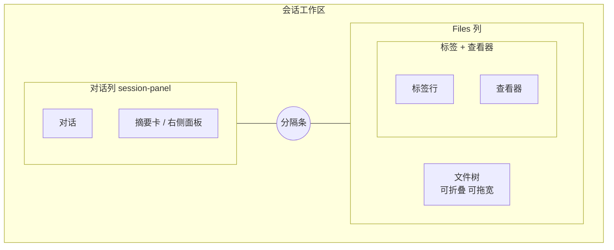

# 文件预览面板：设计稿

2026-11-14 经四轮问答定稿并获批。标「我的判断」的是设计者自定、用户未逐条确认的取舍。问答原件：`.ryugi/artifacts/document/file-preview-pane/`。

## 1. 要做什么，为什么

pig 对话里出现的文件路径现在点不开，只能看工具输出里截取的片段。要在会话旁边加一个只读的 Files 面板，外观和交互对齐 cc-wrapper（也就是 Claude Desktop 的 Files 面板）：左边是工作区文件树，右边是文件标签和查看器。点对话里的路径能直接打开文件，跳到对应行；用户也能自己浏览、搜索工作区。

具体场景你没写。我按「看 agent 读写的完整文件，并能自己浏览工作区」来理解（我的判断）。

## 2. 范围

| 要做 | 不做 |
|---|---|
| 文件树、多标签、查看器（所有类型）、找文件、对话入口、改动后重读 | 编辑和保存；Changes / diff 面板（后续单独排期）；拖拽重排的拼贴引擎；文件右键菜单里的写操作（新建、改名、删除） |

反目标：不在 pig 里做 IDE。凡是写文件的动作都交给 agent。

## 3. 布局

照 cc-wrapper 的排法：Files 是对话列外面的一列。摘要卡和右侧面板（后台任务、上下文预览）留在对话列里面，不跟 Files 争位置。对话列变窄时，摘要卡按现有的 `session-panel` 容器断点自动收起，不用另写规则。

- 对话和 Files 之间是一根可拖的分隔条。Files 的宽度、树的宽度和树的折叠状态都记住，跨会话生效（你定的位置；记住哪些是我的判断）。

- 固定排法：对话在左，Files 在右，不能拖到其他位置（你定的）。

- 对话放不下最小宽度 640 时，Files 盖住对话，头部给一个返回按钮（你定的）。

- 会话头部加一个「文件」按钮，用来开关 Files（我的判断）。

- 分隔条复用 Reka 的 Splitter，不自写拖拽（我的判断）。

## 4. 文件树

- 根目录是会话的工作目录。目录展开时才去读，展开状态按会话记住（我的判断）。

- 全部显示，.gitignore 命中的变灰。gateway 对每次列出的条目跑一次 `git check-ignore --stdin`；不是 git 目录就不变灰（你定的；实现是我的判断）。

- 排序：目录在前，名字按自然序（我的判断，与 cc-wrapper 一致）。

- 图标用已装的 `@pierre/vscode-icons`（我的判断）。

- 从对话里打开文件时，树里展开到它并选中（照 cc-wrapper）。

「不在 pig 内置 Git」这条约束去掉，实现时同步改 `docs/directory-structure.md` 第 3 行（你定的）。树上的只读改动标记跟文件树一起放第 2 期：gateway 新增 `GET /api/v1/platform/git/status`，用 `Environment.exec` 跑 `git status --porcelain`；不是 git 仓库就不着色。样式参照 VS Code 资源管理器：文件名换色，行尾显示字母（我的判断）。Changes 面板后续单独排期（你定的）。

## 5. 找文件

照 cc-wrapper：树顶一个 Search files 输入框，结果分两组，先是文件名匹配，后是内容匹配（每条一行：路径、行号、命中那一行）。点结果打开文件，内容结果跳到那一行（你定的）。

- 文件名匹配复用现有 @ 引用用的 `/api/v1/platform/files` 搜索（我的判断）。

- 内容匹配在 gateway 里新增，逐个读文件扫描，不依赖 ripgrep，跳过二进制和 gitignore 命中的文件；结果和耗时都设上限（我的判断）。

## 6. 标签

- 单击打开临时标签（斜体），下次单击会替换它；双击标签或双击树里的文件才固定（你定的）。

- 按会话记住打开的标签和当前标签；只记路径，不记内容（你定的）。

- 标签太多时，放不下的收进行尾的溢出菜单（照 cc-wrapper；我的判断）。

- 标签头部显示面包屑路径（照 cc-wrapper）。

## 7. 查看器

| 类型 | 怎么显示 | 期 |
|---|---|---|
| 代码 / 纯文本 | 行号 + 高亮，复用 `transcript-view/lib/code-highlight.ts` | ① |
| Markdown | 默认渲染，复用对话正文的 Comark 渲染与 `markdown.css`；头部切换「预览 / 源码」 | ① |
| 图片 png jpg gif bmp webp avif | `img`，地址走字节流接口 | ① |
| CSV / TSV | 表格预览，可切源码 | ③ |
| SVG | 画成图，可切源码；当图片显示，脚本不跑 | ③ |
| HTML | 沙箱 iframe：允许脚本、不同源，拿不到 pig 的凭证；页面里的外链先确认再打开 | ③ |
| 音频 / 视频 | `audio` / `video`，字节流接口支持 Range | ③ |
| PDF | 浏览器自带查看器（iframe 指向字节流接口） | ③ |
| 二进制 / 过大 / 已删除 | 一张说明卡；二进制卡上给「仍按文本查看」 | ① |

- 打开时带行号就滚到那一行；带范围就高亮那几行。Edit 工具打开时用它改动的行范围（你定的）。

- agent 对一个已打开文件的 Edit / Write 完成后，自动重读这个标签，滚动位置不变（你定的）。

- 文本大小上限、高亮放弃阈值沿用 cc-wrapper 的数值；超过高亮阈值时按纯文本显示并提示（我的判断）。

## 8. 入口

- 工具行：Read / Edit / Write 的路径可点，带上行范围（你定的）。

- Markdown：`MarkdownLink.vue` 里，不是 http(s) 也不是 # 的链接，解析成工作区内的路径就在 Files 打开；解析不了的照旧（你定的；判断规则是我的判断）。

## 9. gateway 与协议

全部走 `@pig/environment`，本机和 SSH 用同一套代码。参数照现有 `/files`：带 `cwd` 和工作区内的相对路径；先用 `hostService.isKnownWorkspace(cwd)` 校验，再用 `workspaceEnvironment(cwd)` 取环境，解析真实路径后确认仍在根内，防 `..` 和符号链接跳出去（我的判断）。鉴权沿用浏览器会话 cookie，所以 `img`、`video` 和 PDF 直接用这个地址就能加载。

| 接口 | 做什么 | 期 |
|---|---|---|
| `GET /api/v1/platform/fs/stat` | 类型、大小、修改时间 | ① |
| `GET /api/v1/platform/fs/text` | 读文本，带大小上限和二进制判定 | ① |
| `GET /api/v1/platform/fs/raw` | 原始字节流，带 Content-Type，支持 Range | ① |
| `GET /api/v1/platform/fs/list` | 列一个目录，附 gitignore 标记 | ② |
| `GET /api/v1/platform/fs/search` | 内容搜索 | ② |

数据形状写进 `@pig/protocol`，web 和 gateway 共用（项目约定）。接口路径命名是我的判断。

## 10. 代码落在哪

- 新建 `features/file-pane/`：`index.vue` 是视图入口；`index.ts` 提供 `provideFilePane` / `useFilePane`，对外只暴露「打开文件(path, line, endLine)」和开关（我的判断）。

- `transcript-view` 通过注入键调用「打开文件」，跟现在 `openTaskSessionKey` 的做法一样，不直接引用 file-pane（项目约定：feature 之间单向引用）。

- 现有 `features/preview/` 是图片弹框，不动它（我的判断）。

- 样式只用 `tokens.css` 的 token；弹层包 `ThemeRoot`；动画用 `motion.css`（项目约定）。

## 11. 分期

1. **查看器、标签、入口、面板列**：Files 列和分隔条、窄屏覆盖、头部按钮；标签（临时 / 固定、按会话记住）；代码、Markdown、图片和说明卡；工具行和 Markdown 入口；跳行与高亮；改动后重读；gateway 的 stat / text / raw。此时树的位置先空着，面板只有标签和查看器。

2. **文件树与搜索**：文件树（懒加载、gitignore 变灰、定位当前文件、折叠与拖宽）；Search files 两组结果；gateway 的 list / search。

3. **其余类型**：CSV/TSV、SVG、HTML 沙箱与外链确认、音视频、PDF。

每期单独跑 `pnpm fix:touched` → `pnpm check:touched`，过了再提交一次（项目约定）。每期在 `e2e/` 补一条整页旅程：①「点工具行路径 → 面板打开并定位行」，②「树里展开 → 搜索 → 打开」，③「打开 HTML 与 PDF」（我的判断）。

## 12. 留给实现的人

- 具体间距、标签和树的行高：从 cc-wrapper 的 CSS 量，换成 `tokens.css` 里最近的档；缺档先补 token。

- 状态存储的键名与结构。

- 内容搜索的结果上限和超时数值。

- Edit 的行范围：工具结果没有行号时，在重读后的文件里定位改后的文本，取它所在的行。

- HTML 沙箱的加载方式（第 3 期）：iframe 不同源时，浏览器不会给同站资源带会话 cookie，页面引用的相邻 css、js 会加载失败。要用路径式地址（让相对链接能解析）加短时令牌，或者另开一个源。到第 3 期再定，前提是不能让 iframe 拿到 pig 的 cookie。

## 13. 问答记录

本文档 `.ryugi/artifacts/document/file-preview-pane/` 共三轮，结论都已写进上面各节：第 1 轮定了要文件树、多标签、全部类型、入口、跳行、自动重读；第 2 轮定了独立一列、gitignore 变灰、找文件照 cc-wrapper、临时标签、字节流、HTML 允许脚本、分三期；第 3 轮定了固定排法、摘要卡留在对话列里、窄屏时 Files 盖住对话；评论里定了去掉「不在 pig 内置 Git」的约束；Changes 面板讨论过一轮，决定后续单独排期。
