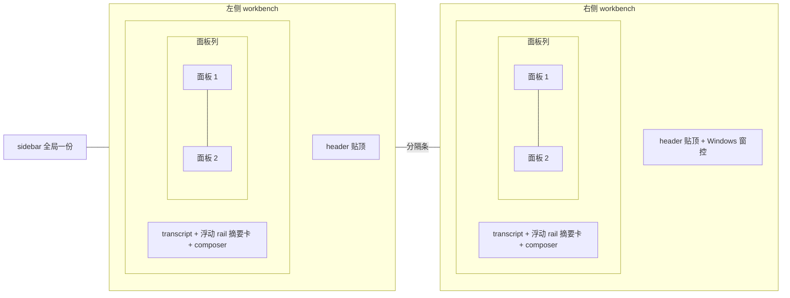
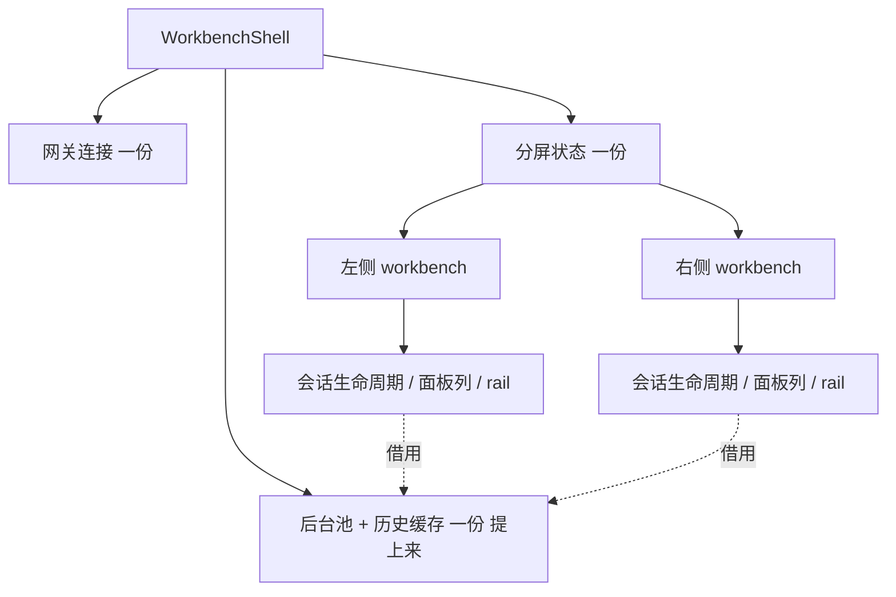

# 双 workbench 分屏布局：设计稿

2026-11-15 经两轮问答定稿并获批。标「我定的」的是设计者自定、用户未逐条确认的取舍。问答原件：`.ryugi/artifacts/document/dual-workbench-layout/`。

## 1. 目的

在同一个窗口里并排开两个会话。典型场景（我的猜测）：一边盯着一个 agent 跑长任务，一边在另一个会话里继续干活，不用来回切，也不会丢掉进度。

同时把右侧功能面板改成「同一列里按打开顺序上下堆叠」的统一规则，给以后的终端、changes 面板留好位置。

## 2. 范围

| 要做 | 不做 |
|---|---|
| 最多两个 workbench，左右排列，中间可拖宽 | 三个及以上、上下分屏、弹出独立窗口 |
| 会话状态、文件面板、session rail 改成每个 workbench 各一份 | 终端、changes 面板本身（只留好接入规则） |
| 功能面板改成一列上下堆叠；任务详情也进这一列 | gateway 和协议改动（不需要） |
| macOS / Windows / Linux / web 四种外壳的窗控与拖窗规则 | Electron 主进程的窗口配置改动（现有配置够用） |

## 3. 布局

- sidebar 全局一份。每个 workbench 有自己的 header、transcript、composer、session rail 和面板列。（我定的）
- workbench 不是卡片，背景平铺。header 贴住窗口顶边。只有功能面板是卡片。（用户定的）
- 两个 workbench 之间有一条分隔条，可以拖宽，双击恢复对半。它从 header 下方才开始响应，header 那一段留给拖窗。做法照搬现在 sidebar 的分隔条。（我定的）
- session rail 的摘要卡浮在 transcript 右上角，不占对话宽度。（用户定的）
- header 右侧的功能图标始终贴住 workbench 的右边。

## 4. 各平台的窗控与拖窗

| 外壳 | 窗控位置 | 谁让位 | 其他 |
|---|---|---|---|
| macOS | 整个窗口左上角，红绿灯 | sidebar 收起时，只有左侧 header 左边让出 `--size-mac-traffic-lights` | 分隔条顶部让出 `--titlebar-inset` |
| Windows | 整个窗口右上角，系统窗控浮层 | 只有最右侧 header 右边让出 `--titlebar-controls-inset` | header 贴顶，窗控高度 44px 不变 |
| Linux | 原生边框 | 无 | 不变 |
| web | 无 | 无 | 窄屏退化见第 6 节 |

两个 header 都是拖窗区，可交互元素照现有规则摘出来。弹层打开时撤掉拖窗区的规则（`desktop.css`）照旧生效。

「只有左侧 / 只有右侧」用 workbench 上的 `data-side` 属性加选择器表达，不靠 JS 计算。单个 workbench 时它同时是左侧和最右侧，两条规则都生效。

## 5. 打开、聚焦与关闭

1. **默认一个**：启动时只有一个 workbench，和现在一样。用户主动分屏才出现第二个。（用户定的）
2. **开到另一侧**（用户定的，Alt+点击和落点提示按 cc-wrapper 补）：
   - sidebar 会话菜单里的「在右侧打开」。已分屏时，文字改成「在另一侧打开」。
   - Alt+点击 sidebar 里的会话。
   - 把会话拖到 workbench 的右半边，拖动时显示落点提示。拖到左半边就替换左侧。
3. **普通点击**：开在最后聚焦的那一侧。聚焦一侧的 header 标题用前景色，另一侧用次级色。（用户定的；视觉处理我定的）
4. **已开着的会话**：要打开的会话已经在另一侧时，不重复打开，直接聚焦那一侧。（用户定的）
5. **关闭分屏**：分屏时每个 header 右端多一个关闭按钮，关掉这一侧，另一侧占满。（按 cc-wrapper 补的）

| 动作 | macOS | Windows / Linux / web |
|---|---|---|
| 在右侧新建会话 | `⌃⌘\` | `Ctrl+Alt+\` |
| 聚焦另一侧 | `⌃[` / `⌃]` | `Ctrl+[` / `Ctrl+]` |
| 关闭聚焦的一侧 | `⌃⌘W` | `Ctrl+Alt+W` |

macOS 键位照抄 cc-wrapper（`split-view-model.mjs` 的 `splitShortcut`）。Windows 上 Ctrl+Win 被系统占用，cc-wrapper 在非 macOS 平台用 Ctrl+Alt，这里照它。（我定的）

## 6. 宽度与高度规则

| 情况 | 规则 |
|---|---|
| 对话最小宽度 | 单个时 640px（现值不变）；分屏时每侧 480px。（门槛我定的） |
| 主区放不下两侧各 480px | 只显示聚焦的一侧，header 出现左右切换按钮；变宽后恢复并排。web 窄屏同样处理。（用户定的） |
| 面板列高度不够 | 每个面板最矮 200px；不够时最早打开的面板先收起，它的 header 图标仍可点回来。（收起规则用户定的；200px 我定的） |
| 面板列宽度不够 | 对话保住最小宽度，整列盖住对话，沿用现在文件面板的做法。（我定的） |
| 新面板位置 | 追加在最下面，已有面板不移动。（用户定的） |
| 面板尺寸 | 面板列和对话之间可以拖宽；面板之间有横向分隔条，可以拖高。列宽和上下比例都记住，两侧共用列宽记录。（用户定的；共用我定的） |
| 900px 以下 | sidebar 照旧变抽屉。 |

## 7. 功能面板列

现在有两种面板：文件面板和任务详情（摘要卡点开的内容）。两者都进同一个面板列，按打开顺序从上到下堆叠，开再多也在这一列里，不另起第二列。只开一个时，它撑满整列高度。（用户定的）

对话与面板列之间用横向的 reka `SplitterGroup`，面板列内部再套一个纵向的 `SplitterGroup`，和现在文件面板用的是同一个件。面板是带圆角的卡片，取值用 `tokens.css` 已有的面板与圆角 token，缺档先补 token。

以后的终端、changes 面板只需要注册成一种面板类型，不改布局代码。

## 8. 会话状态怎么拆

现状：

- `sessionId` 来自路由，`useForegroundSession` 规定「同一时刻只有一条前台连接」，其余运行中的会话进后台池（`useLiveSubscriptions`）。
- 后台池和历史缓存建在 `useForegroundSession` 和 `useSessionHistory` 内部，跟着那一份会话状态走。

1. **后台池和历史缓存提到壳层，两侧共用。** 会话从一侧换到另一侧时，连接从池里取回，不断线，也不重新拉历史。
2. **前台连接改成每侧一条。** 两侧各跑一份 `useSessionLifecycle`，它的 `sessionId` 改成由分屏状态传入，不再直接读路由。池判断「这个会话在前台吗」时，看的是两侧前台的集合。
3. **路由只表示聚焦那一侧的会话。** 地址仍是 `/sessions/:id`。另一侧的会话 id 放在分屏状态里，只存在内存，重开应用回到欢迎页、不分屏。（路由方案我定的；2026-11-26 用户改为不恢复）
4. **每个 workbench 组件里各自 provide** 会话、文件面板、session rail。子树里的 `useSession()` 等调用不用改，自然拿到自己那一侧的状态。
5. **sidebar 只读分屏状态**：高亮两侧开着的会话，点击时把会话交给聚焦的一侧。

分屏状态放在新模块 `features/split-view/`：两侧的会话 id、聚焦哪侧、分隔比例、每侧的面板顺序，以及打开、聚焦、关闭、替换这些状态转换。（模块位置我定的）

## 9. 验收

- 单测（`features/split-view`）：开到另一侧、会话已在另一侧时改为聚焦、关闭一侧、窄屏退化与恢复、最早的面板先收起。
- 单测（`features/session`）：会话换到另一侧时复用池里的连接，不重拉历史。
- e2e：从 sidebar 用菜单在右侧打开会话，两侧分别发消息，关闭一侧。
- `pnpm test:bench`：分屏后两侧同时流式输出时的滚动与耗时。
- `pnpm dev:desktop` 看画面：macOS 与 Windows 下 sidebar 展开 / 收起各一次，确认红绿灯和窗控不压 header 内容，拖窗没有死角。

## 10. 留给实现者

- 落点提示、关闭按钮、切换按钮的具体样式，按 `apps/web/DESIGN.md` 的七条规则和现有 rt 组件来。
- 分屏状态的本地存储键名，沿用现有 `utils/storage` 的写法。
- 拖动会话进 workbench，复用现有的会话拖放（`use-session-drop`）。

## 11. 本次讨论用到的产物

- 设计问答文档：`.ryugi/artifacts/document/dual-workbench-layout/`（document 类型）。两轮问答的结论都已写进本文；其中的布局示意图经用户调整，确定面板在同一列里上下堆叠。
- 用户草图：shell、sidebar、两个 workbench、header、session rail、transcript、composer、功能面板的布局，以及「窗控若有，始终在整个窗口右上角」的标注。
